<div align="center">

# LangChain Agents — From Tools to Autonomous ReAct Agents

### A hands-on journey through **Tools → Tool Calling → AI Agents** in LangChain


*Notes, code, and diagrams from my journey learning LangChain Agents.*

</div>

---

## Table of Contents

1. [About This Repo](#about-this-repo)
2. [Learning Roadmap](#learning-roadmap)
3. [What You'll Learn](#what-youll-learn)
4. [Repo Structure](#repo-structure)
5. [Part 1 — Tools](#part-1--tools)
6. [Part 2 — Tool Calling](#part-2--tool-calling)
7. [Part 3 — AI Agents](#part-3--ai-agents)
8. [The ReAct Pattern](#the-react-pattern)
9. [Agent Executor Flow](#agent-executor-flow)
10. [Getting Started](#getting-started)
11. [Tech Stack](#tech-stack)

---

## About This Repo

This repository is my personal lab for understanding **how LLMs stop being "just chatbots"** and start becoming **autonomous agents** that can think, decide, and act using external tools.

Every notebook builds on the previous one — from the smallest building block (a **Tool**) up to a fully working **ReAct AI Agent** that reasons step-by-step, calls tools, observes results, and produces a final answer.

> **An AI agent is an LLM-powered system that can autonomously think, decide, and take actions using external tools or APIs to achieve a goal.**

---

## Learning Roadmap

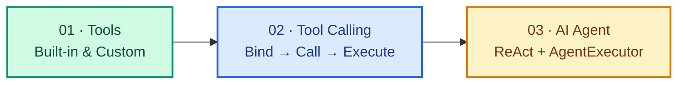

---

## What You'll Learn

| Concept | What It Means |
|---|---|
| **Tools** | Python functions / APIs packaged so the LLM can call them |
| **Built-in Tools** | Pre-built, production-ready tools shipped by LangChain |
| **Custom Tools** | Your own functions exposed to the LLM via `@tool`, `StructuredTool`, `BaseTool` |
| **Toolkits** | Bundled collections of related tools (e.g. `GoogleDriveToolkit`) |
| **Tool Binding** | Registering tools with an LLM so it knows their name, description, and schema |
| **Tool Calling** | The LLM decides *which* tool to call and *with what arguments* — it does not execute |
| **Tool Execution** | You (or LangChain) actually run the Python function with the LLM's suggested args |
| **AI Agent** | Goal-driven, autonomous, tool-using, context-aware, reasoning-capable, adaptive |
| **ReAct** | **Rea**soning + **Act**ing — interleaves `Thought → Action → Observation` loops |
| **AgentExecutor** | The orchestrator that runs the ReAct loop until the agent produces a final answer |

---

## Repo Structure

```
LangChain_Agents/
├── 01_LangChain_Tools/
│   ├── LangChain_Built-in_Tools.ipynb      # DuckDuckGo search, Shell, etc.
│   └── LangChain_Custom_Tools.ipynb        # @tool, StructuredTool, BaseTool
│
├── 02_LangChain_Tool_Calling/
│   ├── LangChain_Tool_Calling.ipynb        # Binding + calling + executing
│   └── LangChain_Tool_Calling_Currency_Converter.ipynb
│
├── 03_LangChain_AI_Agent/
│   └── ai_agent_in_langchain.ipynb         # ReAct agent + AgentExecutor
│
└── requirements.txt
```

---

## Part 1 — Tools

> A **Tool** is just a Python function (or API) packaged in a way the LLM can understand and call when needed.

LLMs are great at **reasoning (thinking)** and **language generation (speaking)** — but on their own they *can't* access live data, do reliable math, call APIs, run code, or query databases. **Tools are the bridge.**

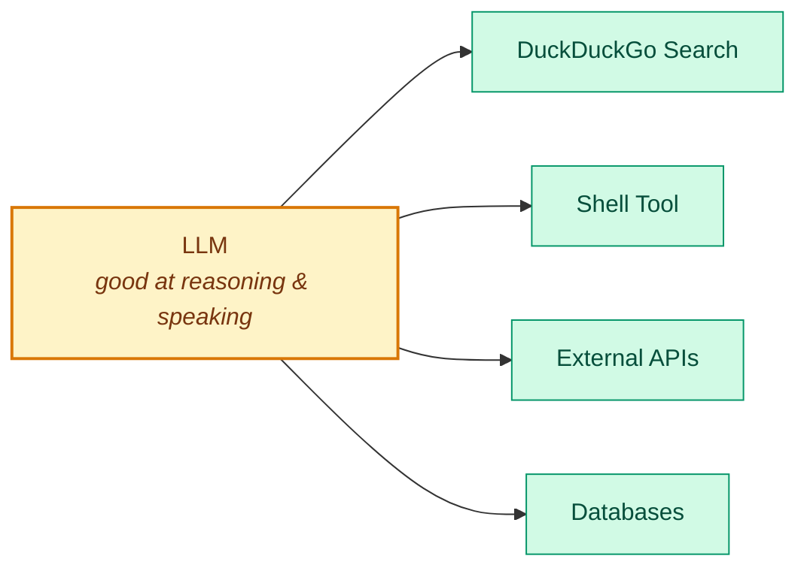

### How Tools fit into an Agent

An agent is simply **LLM + Tools**: the LLM handles reasoning and decision making, the tools handle action.

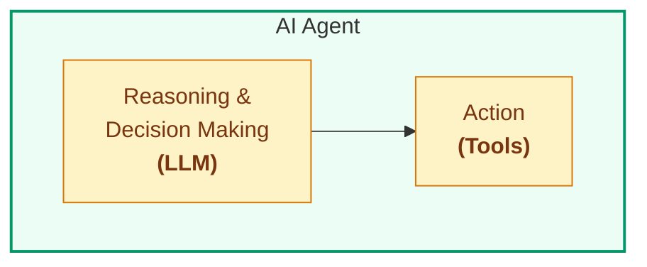

### Types of Tools

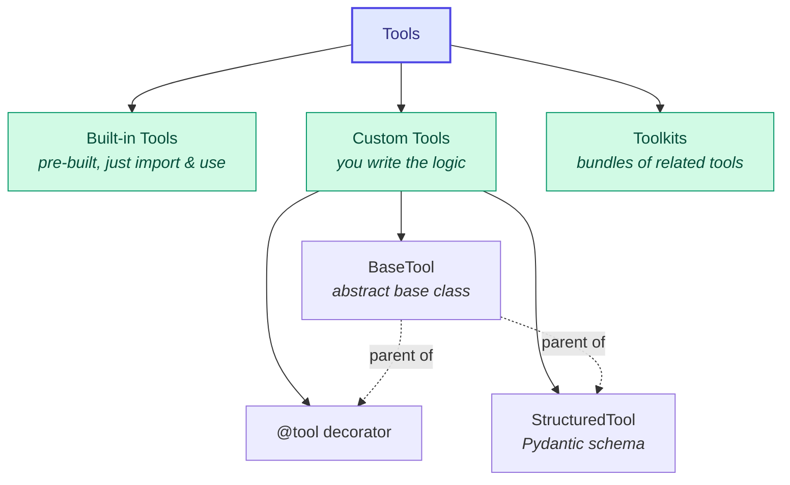

| Built-in Tools | Custom Tools |
|---|---|
| Pre-built & production-ready | You define them yourself |
| Minimal / no setup | Full control over logic |
| Just `import` and use | `@tool`, `StructuredTool`, `BaseTool` |

> Notebooks: [`01_LangChain_Tools/`](01_LangChain_Tools/)

---

## Part 2 — Tool Calling

Once you have tools, the LLM needs to know **which ones exist** and **how to use them**. That happens in three steps:

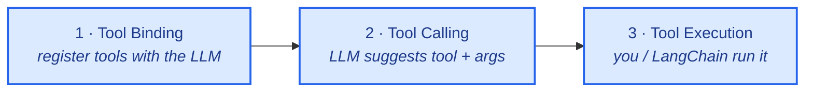

### Step 1 — Tool Binding

Binding tells the LLM three things about every tool:

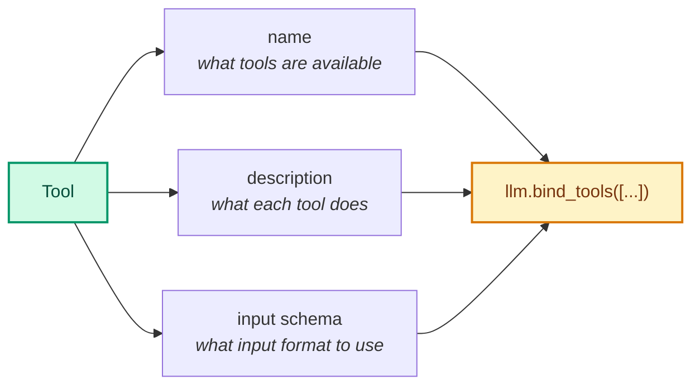

### Step 2 & 3 — Tool Calling and Tool Execution

> The LLM **does not run the tool**. It only *suggests* the tool and its arguments. The actual execution is done by LangChain or by you.

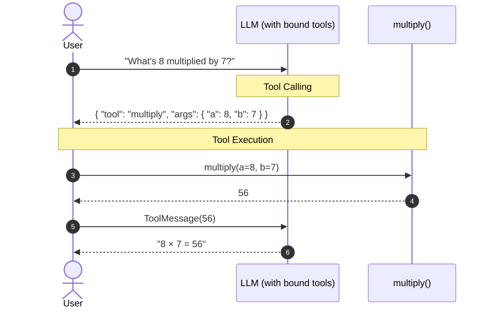

### Mini Project — Currency Converter

A multi-step tool-calling demo. The second tool needs the **output of the first tool**, so the conversion rate is injected at runtime (the LLM is told *not* to fill that argument itself).

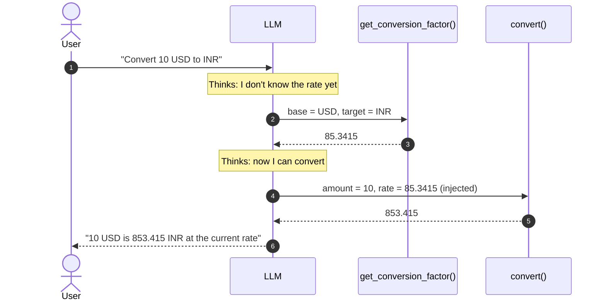

> Notebooks: [`02_LangChain_Tool_Calling/`](02_LangChain_Tool_Calling/)

---

## Part 3 — AI Agents

An AI agent wraps everything above in an **autonomous loop**. You give it a goal — it works out the steps.

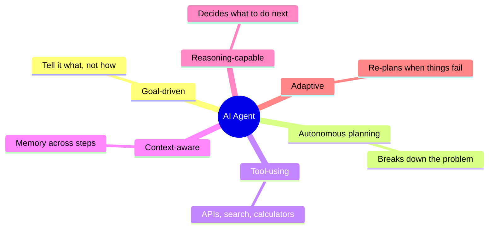

**Example:** *"Plan a budget trip from Delhi to Goa, 1st–7th May."* An agent would understand the intent, research trains and flights, find affordable stays, plan local travel and activities, sum up the budget, and confirm bookings — calling the right tool at each step and checking back with the user.

---

## The ReAct Pattern

**ReAct = Reasoning + Acting.** Instead of answering in one shot, the model **thinks step by step**, decides what to do next, and optionally calls tools to help. It was introduced in *"ReAct: Synergizing Reasoning and Acting in Language Models"* (Yao et al., 2022).

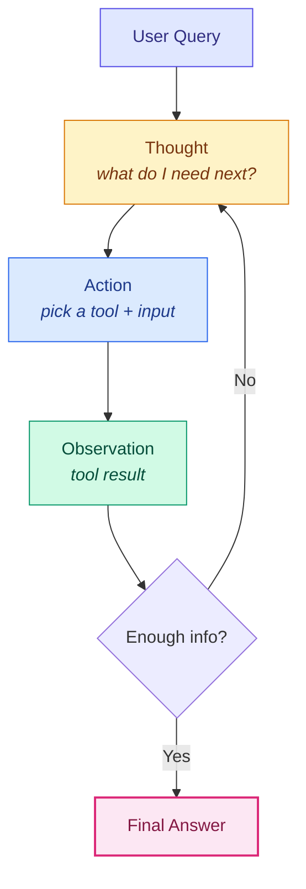

**Example trace:**

```text
Thought:      I need to find the capital of France.
Action:       search_tool
Action Input: "capital of France"
Observation:  Paris
Thought:      Now I need the population of Paris.
Action:       search_tool
Action Input: "population of Paris"
Observation:  2.1 million
Thought:      I now know the final answer.
Final Answer: Paris is the capital of France and has a population of ~2.1 million.
```

ReAct is useful for **multi-step problems**, **tool-augmented tasks** (web search, database lookups), and making the agent's reasoning **transparent and auditable**.

---

## Agent Executor Flow

The **Agent** only *decides* the next step. The **AgentExecutor** *runs* the whole loop:

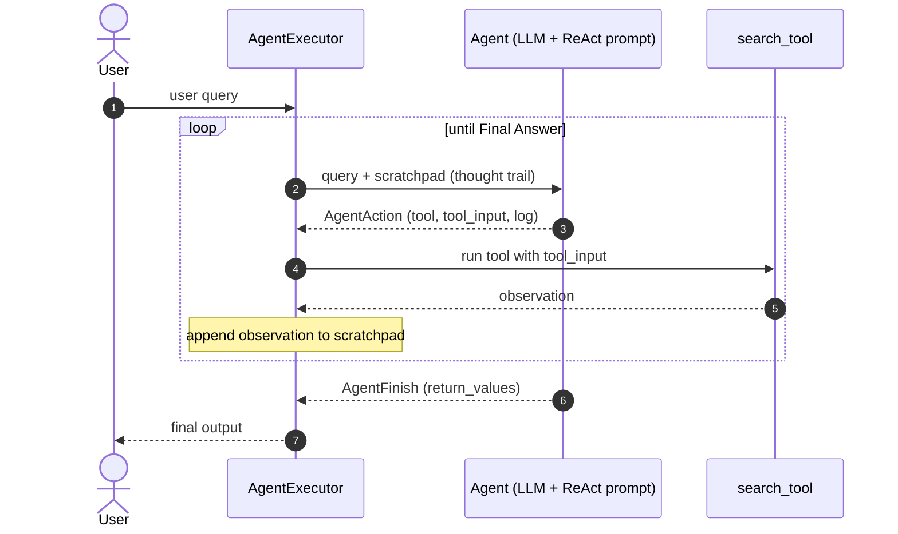

### Full Control Flow

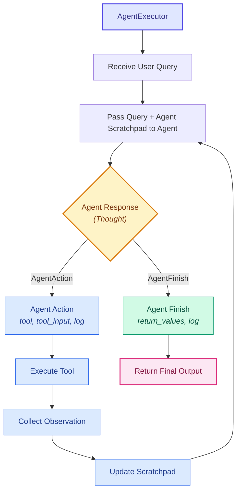

**In code**, this is just two pieces:

```python
from langchain_classic.agents import create_react_agent, AgentExecutor

agent = create_react_agent(llm=llm, tools=[search_tool], prompt=prompt)
agent_executor = AgentExecutor(agent=agent, tools=[search_tool], verbose=True)

agent_executor.invoke({"input": "What is the capital of France and its population?"})
```

> Notebook: [`03_LangChain_AI_Agent/ai_agent_in_langchain.ipynb`](03_LangChain_AI_Agent/ai_agent_in_langchain.ipynb)

---

## Getting Started

### 1. Clone the repo
```bash
git clone https://github.com/<your-username>/LangChain_Agents.git
cd LangChain_Agents
```

### 2. Create a virtual environment
```bash
python -m venv .venv
source .venv/bin/activate      # Linux / macOS
# .venv\Scripts\activate       # Windows
```

### 3. Install dependencies
```bash
pip install -r requirements.txt
```

### 4. Set your API key
Create a `.env` file in the project root:
```env
GOOGLE_API_KEY=your_google_gemini_api_key_here
```

### 5. Launch Jupyter
```bash
jupyter notebook
```

Open any notebook and run the cells top to bottom.

---

## Tech Stack

| Layer | Tooling |
|---|---|
| **LLM** | Google Gemini (via `langchain-google-genai`) |
| **Framework** | LangChain + LangChain Community + LangChain Experimental |
| **Validation** | Pydantic |
| **Config** | `python-dotenv` |
| **Notebooks** | Jupyter |

---

<div align="center">

### If you found this helpful

Give the repo a star — it helps others find these notes.

**Built while learning. Shared for learning.**

</div>
